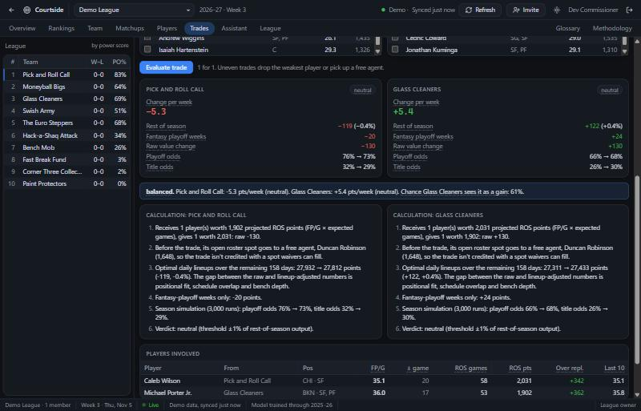

# Courtside

**Know whether that trade actually helps you, before you hit accept.** Courtside connects to your ESPN fantasy basketball league and simulates what a move does to your lineups, your weeks and your playoff odds.



**[Download the desktop app](https://github.com/KrishModi6/fantasybasketball/releases/latest)** for Windows or Mac, with everything bundled: no server, no Python, no account. **Try a demo league** works without connecting anything.

- **Trades:** both rosters re-simulated day by day for the rest of the season, with the verdict and every step of the math. Or let it find trades, target a player, or shop one. A league's admin can rule each trade fair or not fair, with Courtside's numbers beside it, and the whole league sees the call.
- **Waivers and lineups:** add/drop moves tested against your actual lineup, streaming pickups for this week, and who to start each day.
- **Matchups:** this week's head-to-head played out 10,000 times, with your win odds and each player's range.
- **Rankings:** every team's power score, projected record, and playoff and title odds from your real schedule and bracket.
- **Ask in plain English:** an AI assistant answers using Courtside's own numbers and can only state what its tools return.

**Tested on seasons it hadn't seen.** Predicting each season using only earlier ones, its preseason projections were 5% more accurate than ESPN's per game and 12% on season totals, and beat ESPN in all four seasons compared ([the numbers](#backtest-how-much-the-ml-helps)). It also keeps checking itself: the simulator re-runs against real games twice a day. Machine learning is used only where a backtest shows it reduces error, and news, injuries and trades only enter as bounded, labelled adjustments. See [docs/METHODOLOGY.md](docs/METHODOLOGY.md).

It also runs as a website (mobile-friendly, installable as a PWA) from the same code, for a league that wants one shared server.

---

## What it does

| Area | What you get |
|---|---|
| **Player projections** | Per-minute rates for 14 stats, plus minutes and availability, blended from a statistical baseline (Basketball-Reference SPS), ESPN's projection and a LightGBM model. Blend weights are learned out of sample, then updated in-season with Bayesian shrinkage. A player's years in the league set the shape of his season: young players start lower and climb, by less each year, and from year 7 veterans are projected for 2–3% fewer minutes. Every player shows its sources, weights, adjustments and SHAP factors. |
| **Expected fantasy points (xFP)** | The Next Gen Stats idea applied to fantasy. NBA.com tracking prices each player's chances this season: every shot (by a shot model), potential assists, rebound chances, deflections and contests. Projections lean on those chances rather than how many went in, which cut rest-of-season error about 3% in a three-season backtest. Each player shows xFP/G and luck (FP/G minus xFP/G), so the buy-lows and sell-highs stand out. See [METHODOLOGY 1.5.1](docs/METHODOLOGY.md#151-expected-fantasy-points-xfp). |
| **Team strength model** | A day-by-day optimal-lineup simulation for every team over the rest of the season gives weekly score distributions. Teams are ranked by a power score that counts this season's record for the share of the season played and the projected all-play win rate for the rest, with projected records plus playoff and title odds from 5,000 simulated seasons of your actual schedule and bracket. A week-by-week grid shows every team's projected points (or win odds against that week's opponent) for the rest of the season. Each rank comes with a "why": stat-by-stat edges, top contributors, depth, schedule and injury drag. |
| **Team improvement** | Weak spots ranked by points at stake. Add/drop moves are simulated against your lineup. Also: streaming pickups for the current week and daily lineups with a confidence score for every start. |
| **Matchup simulator** | Plays any week's head-to-head out 10,000 times, box score by box score: who suits up, each player's night, bench fill-ins when a starter sits, and points already scored. You get win probability, score and margin distributions, a day-by-day breakdown, each player's range and "swing", and what-if toggles to sit players. Works for points and category leagues. |
| **Trades** | The analyzer re-simulates both rosters and handles 2-for-1 roster spots. It shows the math step by step: raw value, lineup-adjusted change, playoff weeks, and playoff and title odds before and after. The verdict is advantageous, neutral or disadvantageous, and a balanced trade says why it's balanced. Trades can include three teams. The finder screens 1-for-1, 2-for-2 or give-up-to-2-get-1 packages and fully simulates the best ones; you can also target or shop one player. |
| **AI assistant** | Ask in plain English: best waiver pickups, a game plan for this week's matchup, trades to pitch, injury impact, season outlook, power-rankings trash talk. The model calls Courtside's own engine (waiver simulation, trade evaluator, matchup simulator, rankings) and may only state numbers those tools return. **Ask AI** buttons on players, trades and matchups. See [docs/AI.md](docs/AI.md). |
| **League hub** | Accounts, invite links and codes, team claiming, standings, a shared trade board, a live activity feed (WebSockets), injury-change alerts and league-wide projection overrides. |
| **Trade rulings** | The league's admin gets an **Admin** tab listing real trades and board posts, each with Courtside's change per week, playoff and title odds, and verdict for every team, and rules each one **Fair** or **Not fair** with a note. Everyone sees the rulings on the league board, labelled as the admin's call. A ruling is only a label: it never changes Courtside's numbers, and Courtside never writes to ESPN, so a real veto still happens there. See [ADMIN_GUIDE: Trade rulings](docs/ADMIN_GUIDE.md#trade-rulings). |
| **Data** | An ESPN connector (public, or private with cookies), CSV/JSON import for any platform, an adapter for Flaim (unverified, see below), scheduled refreshes, rate limiting and caching. |

## Quick start (local)

Prerequisites: Python 3.11+ and Node 20+.

```bash
cd server
python -m venv .venv
.venv/Scripts/python -m pip install -r requirements.txt
```
(macOS/Linux: `.venv/bin/python`.) The repo already includes the historical dataset and a trained model. To rebuild either, see *Retraining* below.

Start the API:
```bash
cd server
.venv/Scripts/python -m uvicorn app.main:app --reload --port 8000
```

Start the web app (proxies `/api` to :8000):
```bash
cd web
npm install
npm run dev
```

Open http://localhost:5173, create an account, then **Try a demo league** or **Connect ESPN league**. For a ready-made local account with a demo league, run `python -m scripts.seed_dev` in `server/`; the credentials are at the top of that script.

### Desktop app
```bash
cd desktop
npm install
npm start
```
`npm start` builds the web app and opens it in Electron. Release builds bundle the engine (`server/engine.py`, frozen with PyInstaller) and start it on `127.0.0.1` with the database in the user's app-data folder, so the app works with nothing else installed and signs its one local user in automatically.

- **Windows:** `npm run dist:win` → `desktop/release/Courtside-Setup-<version>.exe` (builds and self-tests the engine first).
- **macOS:** `npm run dist:mac` on a Mac → `Courtside-<version>-mac-arm64.zip`, ad-hoc signed. Without an Apple Developer ID, friends approve it once: the release notes walk through moving it to Applications and clearing the download flag (`xattr -cr /Applications/Courtside.app`) or using System Settings > Privacy & Security > Open Anyway.
- **Release notes:** `desktop/release-notes.md` becomes the release page. To fix the notes of a published release without rebuilding, run the **Update release notes** workflow from the Actions tab.
- **Releases:** bump the version in `desktop/package.json`, then push a matching tag like `v0.2.0`. `.github/workflows/release.yml` builds both, self-tests a real Windows install, and publishes a GitHub release with [these notes](desktop/release-notes.md) and the update feed (`latest.yml`, `latest-mac.yml`, `.blockmap` files). It refuses a tag that doesn't match `desktop/package.json`. Each release needs a `## What's new in X.Y.Z` section in the notes, or the app's What's new shows nothing for it. To build and self-test without publishing (the check before merging), run it with `-f publish=false`. After each published release, `update-test.yml` installs the two releases before it and checks that each updates itself to the new one.
- **Auto-update:** installed apps check the newest GitHub release shortly after launch, every 15 minutes, and when the computer wakes up or Courtside comes back to the front after 15+ minutes, so a laptop that mostly sleeps still checks (`electron-updater`). The update downloads in the background; people get an "Update now" prompt, or it installs the next time they close the app. On Windows electron-updater installs it. The Mac app is only ad-hoc signed, and electron-updater can only install Mac updates signed with an Apple Developer ID, so `desktop/mac-update.js` does it there: it downloads the zip itself (macOS only flags browser downloads, so no `xattr` step), checks it against the SHA-512 in `latest-mac.yml`, unzips it with `ditto`, and swaps the new app in after Courtside quits. If macOS refuses the swap, the old copy stays and shows the downloaded one in Finder to drag over. The release workflow runs that whole path on the macOS build (`desktop/scripts/test-mac-update.mjs`). The top bar shows the installed version and whether it's current; clicking it, or Help > Check for updates…, checks on demand. Logs: `updates.log` next to the engine log.
- **Window and What's new:** the window has no system title bar. Each page's top bar is the title bar (`-webkit-app-region: drag`). Windows and Linux draw their window buttons over its right end in the theme's colors (`titleBarOverlay`, recolored when the theme changes), and the app menu opens from a ☰ button there. A Mac keeps its traffic lights at the left. The first launch of a new version shows the release notes since the last version opened on that computer, read from `desktop/release-notes.md` (bundled with the app, and the same text as the GitHub release). Help > What's new in Courtside, or the version in the status bar, shows them all.
- **Trade rulings between desktop apps:** each copy of the app has its own database, so for ESPN leagues the admin's copy sends rulings through the same Cloudflare Worker as the AI assistant, and every other copy reads them in at most once a minute. The Worker only sees a hash of the league ID and season. The first copy to make a ruling claims the league with a random key only it holds; an admin whose copy came from an invite code (or who moved computer) enters an admin code under **League admin** on the League tab instead. Demo and file leagues keep their rulings on the one computer.

Without a bundled engine (plain `npm start` before `npm run build:engine`), the app connects to a Courtside server instead: `COURTSIDE_SERVER`, or `http://localhost:8000`.

### Mobile
The website is fully responsive (the tab strip scrolls and tables scroll inside their panels on phones), and it's installable as a PWA (Add to Home Screen) on iOS and Android. Everything syncs through the server in real time.

## Connecting your league

The ESPN connector talks to ESPN's fantasy API directly. Its field mappings were cross-checked against the open-source [cwendt94/espn-api](https://github.com/cwendt94/espn-api), and it borrows that library's handling of live matchup points and in-progress category totals. It isn't a dependency, because it reads the same endpoints this connector already does.

- **ESPN (recommended).** Paste your league URL or ID. Private leagues also need the `espn_s2` and `SWID` cookies from a logged-in browser (DevTools → Application → Cookies → fantasy.espn.com). They're encrypted at rest and only used to read the league. Your league's real scoring settings, lineup slots, schedule, matchups and acquisition limit are mirrored on every refresh.
- **File import.** CSV (`team, player[, owner, slot]`) or JSON. Rosters come from the file; stats, injuries and the NBA schedule still refresh from ESPN's public data. Details in [docs/CONNECTORS.md](docs/CONNECTORS.md).
- **Flaim.** Flaim exposes leagues via an MCP server for AI assistants, with no public REST API, and its output format is unpublished. The adapter speaks MCP over HTTP and maps rosters defensively, but it's **unverified**. To try it you need a Flaim OAuth access token and your league ID as Flaim knows it. For ESPN leagues, the direct connector is better.

## Backtest (how much the ML helps)

Rolling origin: each season is predicted using only earlier seasons. Error is in fantasy points per game under the reference league's scoring (ESPN default H2H points).

**Head-to-head with ESPN**, on players with 20+ games and a genuine ESPN preseason projection (2021‑22, 2023‑24, 2024‑25, 2025‑26):

| Method | FP/G MAE | FP/G RMSE | Season-total MAE | Rank ρ |
|---|---|---|---|---|
| Last season repeated | 4.80 | 6.08 | 514 | 0.668 |
| Statistical baseline (SPS) | 4.56 | 5.83 | 469 | 0.704 |
| ESPN preseason projection | 4.57 | 5.79 | 507 | 0.736 |
| LightGBM alone | 4.41 | 5.60 | 456 | 0.729 |
| **Courtside ensemble** | **4.33** | **5.49** | **446** | **0.737** |

The ensemble is 5% more accurate than ESPN per game and 12% more accurate on season totals, and it beat ESPN in every one of these seasons; ranking accuracy is a statistical tie. A data audit excluded ESPN's stored projections for 2019‑20 and 2022‑23, because they were refreshed in-season, and removed ADP as a feature because ESPN overwrites it for past seasons. Both choices are documented in the methodology.

## Project layout

```
server/            FastAPI backend + analytics engine
  fbb/             engine (no web deps): projections, lineup optimiser, strength, trades, valuation
    matchup_sim.py Monte Carlo matchup simulator
    connectors/    espn, file import, flaim (MCP), demo
    ml/            feature builder + LightGBM wrapper
  app/             API: auth, leagues, invites, analysis, trades, realtime, scheduler, AI assistant
  engine.py        desktop engine entry point (PyInstaller: courtside-engine.spec)
  scripts/         data and model (build_history, fetch_game_logs, fetch_tracking, train_model, xfp_report),
                   backtests (backtest_recency, backtest_sims, backtest_xfp), AWS (push_tracking_s3, and the
                   daily check: daily_sims, daily_lambda, sims_lambda), seed_dev
  data/history/    player-season dataset 2017-18 → today (from ESPN)
  data/model/      trained model + metrics.json (the backtest above)
  tests/           engine unit tests + end-to-end API test
web/               React + TypeScript + Vite client (also the desktop UI)
desktop/           Electron shell; starts the bundled engine; installers in desktop/release
cloudflare/ai-proxy/  Worker + D1 that holds the OpenAI key and meters AI calls for the desktop app, and
                   carries league admins' trade rulings between desktop apps
docs/              methodology, API, user guide, admin guide, connectors
```

## Tests

```bash
cd server && .venv/Scripts/python -m pytest      # the API test needs internet once; ESPN data is cached
cd web && npm test && npm run typecheck
cd cloudflare/ai-proxy && npm test                # the Worker (AI proxy and rulings) against SQLite and a stubbed OpenAI
cd server && .venv/Scripts/python engine.py --self-test   # the desktop engine end to end
```

## Deploying for your league

Everyone in a league needs to reach one server. The simplest option is the included Dockerfile on any container host (Fly.io, Render, Railway, a VPS):
```bash
docker build -t courtside .
docker run -p 8000:8000 -v courtside-data:/app/server/data/db -e FBB_SECRET_KEY=... -e FBB_PUBLIC_URL=https://your.host courtside
```
Free hosting (Cloud Run + Neon, or Render): see [docs/DEPLOY.md](docs/DEPLOY.md). Hosts that scale to zero stop the built-in refresh scheduler while idle, so `.github/workflows/sync.yml` asks the server to refresh due leagues every 3 hours once `COURTSIDE_URL` and `COURTSIDE_CRON_TOKEN` are set as repository secrets. Environment variables, backups and scaling: [docs/ADMIN_GUIDE.md](docs/ADMIN_GUIDE.md).

## Retraining

```bash
cd server
.venv/Scripts/python -m scripts.build_history     # refresh player seasons + ages from ESPN
.venv/Scripts/python -m scripts.fetch_game_logs   # game logs for the overdispersion estimate
.venv/Scripts/python -m scripts.train_model       # backtest, learn blend weights, save model + metrics
.venv/Scripts/python -m scripts.fetch_tracking    # NBA.com shots + tracking (home connection; NBA.com blocks cloud hosts)
.venv/Scripts/python -m scripts.backtest_xfp      # shot model, xFP weights and established rates -> xfp_model.joblib
.venv/Scripts/python -m scripts.xfp_report        # this season's luck board: who is running hot or cold
```
The server hot-reloads the model when the file changes. Set `FBB_RETRAIN_ENABLED=true` to retrain weekly.

## AWS (optional)

The NBA.com tracking cache and the xFP model also live in a private, versioned S3 bucket in the `courtside` AWS project (`us-east-2`). After `fetch_tracking`:
```bash
cd server
.venv/Scripts/python -m pip install -r requirements-dev.txt   # once: boto3[crt]
aws login --profile courtside                                 # when the 12-hour session has lapsed
.venv/Scripts/python -m scripts.push_tracking_s3              # sends only changed files; --dry-run to preview
```
The same bucket feeds xFP (Courtside 0.5.0): a daily task on the home PC runs `push_tracking_s3 --live`, which publishes this season's tracking file to the bucket's `public/` folder, and every app downloads it through CloudFront (`https://d3n5zp4ghqw542.cloudfront.net`) before asking NBA.com itself. Set `FBB_TRACKING_URL=""` to skip it.

AWS also runs the simulator's accuracy check: at 7:30 AM and 6:30 PM Eastern, EventBridge Scheduler starts a Lambda function that replays the season so far against real games.

[docs/AWS.md](docs/AWS.md) covers what's in the bucket and how it's locked down, the daily feed and its scheduled task, the Lambda sims and what everything costs, why the AI assistant stays on OpenAI rather than Amazon Bedrock, and which AWS services would be overkill here.

## Documentation

- [Methodology & model card](docs/METHODOLOGY.md)
- [User guide](docs/USER_GUIDE.md)
- [Admin guide](docs/ADMIN_GUIDE.md) (including trade rulings and admin codes)
- [Deploying a shared server](docs/DEPLOY.md)
- [API reference](docs/API.md) (interactive docs at `/docs` on a running server)
- [AWS: S3 backup, Lambda sims, Bedrock evaluation, costs](docs/AWS.md)
- [Connectors](docs/CONNECTORS.md)
- [AI assistant and the Cloudflare proxy](docs/AI.md)
